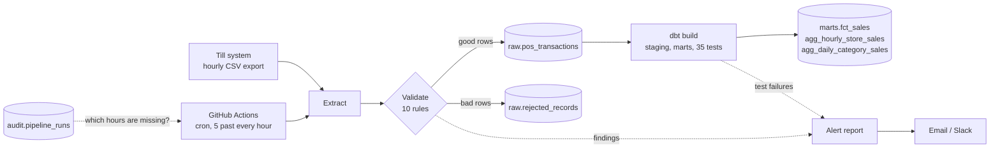

# Supermarket Sales Pipeline


An automated, tested and monitored data pipeline that loads a supermarket chain's till sales into a Postgres warehouse every hour, checks the data at two levels, and emails the team when something is wrong.

**Stack:** Python, pandas, PostgreSQL, dbt, GitHub Actions, pytest, Docker

## The scenario

FreshWay is a supermarket chain with six stores across Gauteng, the Western Cape and KwaZulu-Natal. Head office wants up to date sales figures every hour, loaded into their database automatically. If the data has problems, the team should hear about it straight away instead of finding out from a wrong report a week later.

This project is that pipeline, built the way I would build it for a real client.

## What it does every hour



1. **Schedule.** GitHub Actions starts the run at five past every hour.
2. **Work out what to load.** The pipeline checks its own audit table and finds every hour in the last 24 that has not loaded successfully. Normally that is just the last hour, but if a run was skipped or failed, it catches up on its own.
3. **Extract** the hourly POS export from the landing zone.
4. **Validate** every row against 10 rules (unknown products, price mismatches, totals that don't add up, duplicates, timestamps outside the hour and more). Good rows carry on. Bad rows go to a quarantine table with the exact reasons, so nothing is silently dropped.
5. **Load** good rows into Postgres. Loads are idempotent, so re-running any hour never creates duplicates.
6. **Transform and test with dbt.** dbt builds a star schema and summary tables, then runs 35 data tests on the result.
7. **Alert.** Everything worth knowing from the run goes out in one email (and optionally Slack). A run with critical problems also exits with an error, so it shows up red in GitHub Actions.

## Why the design looks like this

The short version, with the long version in [docs/design_decisions.md](docs/design_decisions.md):

- **Two quality gates, not one.** Python checks each row before it touches the database. dbt then tests the modelled data as a whole (keys, relationships, totals reconciling). Each layer catches things the other can't.
- **Quarantine instead of delete.** A rejected row is evidence of a problem at a till. Keeping it, with its reasons, makes the problem easy to investigate.
- **Self healing scheduling.** The pipeline doesn't assume the scheduler is perfect. It compares what should have loaded with what did, and fills the gaps.
- **Safe to re-run anything.** Primary keys plus `ON CONFLICT DO NOTHING`, and an incremental dbt model keyed on load time, mean backfills and retries are boring.
- **One alert per run, with severity.** A few rejected rows is a warning. A high reject rate, a missing export, or a failed dbt test is critical. No inbox flooding.

## Realistic data

There is no public hourly till data for a South African supermarket, so the pipeline includes a POS simulator that stands in for the till system. It is built to behave like the real thing:

- Stores only trade during their opening hours (SAST), with lunch and after work peaks
- Weekends are busier, and month end payday weekends are busier still
- 47 products with realistic 2026 prices, including correct VAT treatment (basic foods like maize meal, brown bread and milk are zero rated)
- About 8% of lines carry a promotion discount
- Card, cash and mobile wallet payments, with cash share varying by store
- Now and then a store's till system goes down (no data), or a till goes faulty and sends broken records

Each hour is seeded from its own timestamp, so the same hour always produces exactly the same data. In production you would swap the simulator for the real export (an SFTP drop or a bucket) by setting `SIMULATE_SOURCE=false`; everything downstream stays the same.

A payday Friday across all six stores comes to about 2,200 baskets, 9,000 sales lines and R574,000 in revenue.

## Quick start

You need Python 3.11+ and Docker.

```bash
git clone https://github.com/YOUR_GITHUB_USERNAME/supermarket-sales-pipeline.git
cd supermarket-sales-pipeline
python -m venv .venv && source .venv/bin/activate
make install
cp .env.example .env

make db-up        # Postgres in Docker
make init         # schemas and raw tables
make backfill     # load a full trading day (25 Sept 2026, a payday Friday)
make test         # 40 unit and integration tests
```

Then look at the results:

```sql
select store_name, sales_hour, transactions, revenue, avg_basket_value, cash_share_pct
from marts.agg_hourly_store_sales
where sales_date = '2026-09-25' and sales_hour = 17
order by revenue desc;
```

```
      store_name       | sales_hour | transactions | revenue  | avg_basket_value | cash_share_pct
-----------------------+------------+--------------+----------+------------------+----------------
 FreshWay Soweto       |         17 |           49 | 11934.36 |           243.56 |           24.6
 FreshWay Bellville    |         17 |           41 | 11933.84 |           291.07 |           32.3
 FreshWay Hatfield     |         17 |           34 |  7655.37 |           225.16 |           42.7
 ...
```

To see the alerting work, simulate a faulty till:

```bash
INCIDENT_PROBABILITY=1 BAD_RECORD_RATE=0.2 python -m pipeline batch --hour 2026-09-26T09:00
```

The run exits with code 1 and produces this report (by email, if you've configured SMTP in `.env`):

```
[CRITICAL] Sales pipeline: 211 of 1087 rows rejected (19.4%)

What needs attention
[CRITICAL] 211 of 1087 rows rejected (19.4%) for 2026-09-26 09:00 UTC
    duplicate_line: 30
    invalid_payment_method: 34
    invalid_quantity: 20
    line_total_mismatch: 56
    missing_or_malformed_field: 29
    outside_batch_window: 30
    price_mismatch: 36
    unknown_product: 32

Hours processed in this run
2026-09-26 09:00 UTC  received 1,087  loaded 876  rejected 211  (success_with_warnings)
```

## Commands

```bash
python -m pipeline init-db                      # create schemas and raw tables (safe to re-run)
python -m pipeline hourly                       # load every missing hour (what the scheduler runs)
python -m pipeline batch --hour 2026-10-05T13:00
python -m pipeline backfill --start 2026-10-01T00:00 --end 2026-10-01T23:00
```

Add `--skip-dbt` to any of them to load raw data only. Run `make help` for the shortcuts.

## Running it on a schedule

The [hourly workflow](.github/workflows/hourly-pipeline.yml) runs the pipeline at five past every hour against a hosted Postgres (Neon and Supabase both have free tiers). Setup takes about ten minutes and is covered step by step in [docs/runbook.md](docs/runbook.md#deploying-the-hourly-schedule).

The [CI workflow](.github/workflows/ci.yml) runs on every push. It lints, runs the test suite against a real Postgres, loads a full day end to end with every dbt test passing, checks that bad data fails the run, and checks that re-running hours doesn't change the row count.

## Project structure

```
├── pipeline/                  Python package
│   ├── run.py                 orchestrator and CLI
│   ├── generator.py           POS simulator (the stand in source system)
│   ├── extract.py             reads the hourly export
│   ├── validate.py            10 row level data quality rules
│   ├── load.py                idempotent loads into Postgres
│   ├── checks.py              decides what is worth alerting on
│   ├── alerts.py              email, Slack and health check pings
│   ├── dbt_runner.py          runs dbt and reads its results
│   ├── audit.py               run history and catch-up logic
│   └── config.py, db.py, models.py, reference.py, schema.py
├── dbt/supermarket/
│   ├── seeds/                 stores and product catalogue (shared with Python)
│   ├── models/staging/        cleaned views over raw data
│   ├── models/marts/          fct_sales, dims and summary tables
│   ├── macros/                custom positive_value test
│   └── tests/                 singular tests (totals reconcile, no future sales, ...)
├── sql/init.sql               raw, quarantine and audit tables
├── tests/                     pytest unit and integration tests
├── docs/                      architecture, data quality, data dictionary, runbook, decisions
├── .github/workflows/         hourly schedule and CI
├── docker-compose.yml         local Postgres
└── Makefile
```

## Documentation

| Doc | What's in it |
|---|---|
| [Architecture](docs/architecture.md) | Components, the life of an hourly run, warehouse layers, time zones |
| [Data quality](docs/data_quality.md) | Every validation rule and dbt test, and how severity is decided |
| [Data dictionary](docs/data_dictionary.md) | Every table and column |
| [Runbook](docs/runbook.md) | Deploying the schedule, and what to do when each alert fires |
| [Design decisions](docs/design_decisions.md) | Why things are built this way, trade offs, and what I'd add next |

The dbt project is documented too. Run `make dbt-docs` to browse the models and the lineage graph.

## About

Built by Banele Gumede, an Information Systems Honours student at the University of the Western Cape, as part of my data engineering portfolio.
